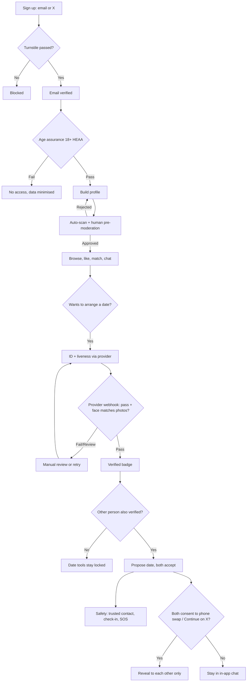

# [NAME TBD] — Platform Spec v0.1 (for founder review)

Transcribed from `platform-spec-v0.1.pdf` (17 pages, printed from the Grok-hosted spec page) and `sections-14-16.txt` (pasted by Travis on 10 Nov 2026). Machine-readable copy so any AI agent can work from it.

**Gaps in the source.** The PDF printed only the panels that were open on the page. These parts were collapsed or on unselected tabs and are **not in the source**: section 3 feature tables for every module except "Auth and account"; section 4 tables except "Identity and auth"; section 5 API tabs except "Auth"; section 13 tasks except P1-1 and P1-2. What the build does in those areas is listed in [DERIVED.md](DERIVED.md) for sign-off.

Markers used by the spec: **[UNVERIFIED]** could not confirm from a primary source. **[LEGAL]** needs a UK solicitor's sign-off. Prices are indicative.

---

## Document status

| | |
|---|---|
| Status | Draft, awaiting Travis approval (approved as the build baseline on 10 Nov 2026, see DECISIONS D-001) |
| Version | v0.1, 3 Nov 2026 (UK time) |
| Owner | Travis Lee Swift, Harrow, UK |
| Next step | Travis reviews, settles Open decisions, then the approved spec goes to the Grok Build CLI bot. |

> **Not legal advice.** The legal points are a working checklist drawn from public sources. The creator agency carries criminal-law risk; get a UK solicitor experienced in online safety and adult content to review before Phase 2.

## 1. Overview and principles

Two products under one company, kept apart on purpose. The dating side is free, for verified adults, built for real people meeting for dinner and relationships. The creator agency side is paid, for creators building a public image and fans paying for content, and it never arranges in-person contact.

| Principle | What it means in the build |
|---|---|
| Real people only | No bots of any kind: Turnstile, age assurance, liveness, rate limits, behaviour scoring and a 'report bot' button. |
| Verify before you meet | ID + liveness for both people before any date tool, phone swap or 'Continue on X' unlocks. |
| Integration first | Auth, realtime chat, media, moderation and notifications are built and working before visual polish. Every link works. |
| Privacy by default | Sexuality and identity are special category data: explicit consent, encryption, minimal display, DPIA. We never store ID documents. |
| Safety over growth | Pre-moderate photos and profiles; act on reports fast; design for the worst user, not the average. |
| Hard separation | Dating side: free, no paid performers. Creator side: paid, no meet-ups, ever. Separate surfaces, roles, rules and enforcement. |
| Explainable moderation | Every action has a reason code, is logged, and can be appealed. |

## 2. User journeys

**Dater: sign-up to first date**
1. Sign up — with X or email; passes Turnstile; confirms email.
2. Prove 18+ — quick age assurance via provider (face estimation or ID).
3. Build profile — photos, bio, identity categories (optional, with explicit consent), country of origin, looking-for.
4. Wait for approval — photos and bio scanned and checked by a moderator, typically within hours (target to set).
5. Browse and match — filters, likes, mutual match opens a chat.
6. Get verified — ID + liveness when they want to meet; Verified badge appears.
7. Arrange the date — both verified: propose, accept, share with trusted contact, set check-in.
8. Optional swap — both consent to swap numbers or continue on X.

**Other journeys**
- Reporter — reports a profile as a bot or scam from the chat; gets an acknowledgement and an outcome notice.
- Moderator — works the pre-moderation and report queues; warns, suspends or bans with reason codes; escalates CSAM/threat-to-life to admin.
- Admin — manages staff roles, categories, law-enforcement requests, dashboards and policy versions.
- Leaver — exports data, deletes account; profile hidden at once and erased on schedule.
- Creator (Phase 2) — applies, verifies ID, signs agency agreement, buys a package, builds portfolio, uploads content with co-performer records.
- Fan (Phase 2–3) — passes age assurance, pays via adult processor, views and interacts with content online only.
- Visitor — reads public pages, uses the contact form; sees no profiles until signed up and age-checked.

## 3. Features by module

Each row is a feature and its acceptance criteria. Modules marked Phase 2/3 are not in the MVP.

**Auth and account**

| Feature | Acceptance criteria |
|---|---|
| Sign in with X (OAuth 2.0 + PKCE) | User can sign up and sign in with X; X user id linked to account; no X password ever touches our servers; tokens kept server-side only. |
| Email + password | Sign-up with email, verified by a one-time link before profile goes live; password hashed (Argon2id via WASM, or PBKDF2-SHA256 at OWASP iteration count if Workers CPU limits bite — benchmark). |
| Password reset | Single-use, 30-minute token by email; all sessions revoked on reset; same response whether or not the email exists. |
| Sessions | HttpOnly, Secure, SameSite=Lax cookie; session list with 'sign out everywhere'; re-auth for sensitive actions (delete, phone swap, email change). |
| Account deletion | Self-serve delete: profile hidden at once, personal data erased within 30 days except records we must keep (moderation/ban hashes, legal holds, financial records); confirmation email sent. |
| Data export | User can download their data (UK GDPR access/portability) as JSON + photos within 30 days, ideally instant. |
| Bot gate | Cloudflare Turnstile on sign-up, sign-in, reset, contact form; failed challenge blocks request server-side. |

Collapsed in the source (not transcribable): Age assurance (18+), Profiles, Discovery and matching, Chat, Dates and safety, Notifications, Site and contact, Creator agency (Phase 2), Payments (Phase 3).

## 4. Data model

Table-level outline; types and indexes are set in task P0-2. Fields marked `_enc` are encrypted at application level.

**Identity and auth**

| Table | Key fields | Purpose |
|---|---|---|
| users | id, email (unique, nullable for X-only until captured), email_verified_at, password_hash, status (active/suspended/banned/deleted), role (member/creator/fan/mod/admin), created_at, deleted_at | Core account |
| oauth_accounts | id, user_id, provider ('x'), provider_user_id, handle, linked_at | X sign-in link; no tokens kept long-term unless needed |
| sessions | id, user_id, created_at, last_seen_at, ip_hash, ua_hash, revoked_at | Cookie sessions |
| auth_tokens | id, user_id, kind (email_verify/reset/reauth), token_hash, expires_at, used_at | Single-use tokens |
| consents | id, user_id, kind (special_category/marketing/explicit_media/x_link/phone_swap), granted_at, withdrawn_at, version | UK GDPR consent ledger |

Collapsed in the source: Verification, Profiles and discovery, Chat and dates, Trust and safety, Agency and payments (Phase 2–3).

## 5. API routes

JSON over HTTPS; all state-changing routes need a session, CSRF protection and rate limits.

**Auth tab**

| Method | Route | Purpose |
|---|---|---|
| POST | /api/auth/signup | Email sign-up (Turnstile token required) |
| POST | /api/auth/login | Email sign-in |
| GET | /api/auth/x/start | Begin Sign in with X (PKCE) |
| GET | /api/auth/x/callback | X OAuth callback |
| POST | /api/auth/logout | End session |
| POST | /api/auth/verify-email | Confirm email token |
| POST | /api/auth/reset/request | Send reset link |
| POST | /api/auth/reset/confirm | Set new password |
| GET | /api/me | Current user + flags |
| GET | /api/me/sessions | List sessions |
| DELETE | /api/me/sessions/:id | Revoke a session |
| GET | /api/me/export | Request data export |
| DELETE | /api/me | Delete account (re-auth) |

Tabs not in the source: Verification, Profiles, Chat, Dates, Safety, Admin, Agency (Ph2–3).

## 6. Realtime design

| Component | Role |
|---|---|
| ChatRoom Durable Object (one per conversation) | Holds WebSocket connections for both members using the Hibernation API (no compute billed while idle); stores recent messages in its SQLite storage; enforces membership, blocks and per-sender rate limits. |
| UserHub Durable Object (one per user) | Presence, unread counts, new-match and moderation notifications; fans out to all of a user's tabs/devices. |
| Message pipeline | Client sends → ChatRoom validates → contact-detail shield + keyword flags run inline → message broadcast → copy queued to the archive table and scan queue. |
| Media in chat | Uploaded to private R2 via signed URL; delivered only after scan passes; explicit images blurred unless the receiver has opted in. |
| Offline delivery | If the receiver has no live socket, the notify queue sends a Web Push or email digest with no message content. |
| Date timers | DateTimer Durable Object alarms fire check-in reminders and alerts at the set time, surviving restarts. |
| Moderation actions | A ban or block closes sockets at once and freezes the conversation. |
| Scale note | Each conversation is its own object, so load spreads naturally; group chats are out of scope for v1. |

> **X Chat and calls.** An X Chat API and encryption SDK (Chat XDK) do exist, reported live since 30 July 2026, but they let an authorised app send and receive a user's encrypted DMs. They are not an embeddable chat widget. No public API for X calls was found [UNVERIFIED]. Recommendation: build chat in-app and offer a 'Continue on X' link once both people consent. The exact XChat deep-link format is [UNVERIFIED]; fall back to a link to the other person's X profile.

## 7. Verification flow



## 8. Admin console

| Area | Specification |
|---|---|
| Access | Separate admin subdomain behind Cloudflare Access (SSO + hardware key or TOTP) and in-app roles. No admin routes on the public app. |
| Roles | Moderator (queues, warn, restrict, suspend up to 7 days); Senior moderator (ban, appeals, ban-evasion review); Trust and safety lead (CSAM/LE escalations, policy); Admin (staff, settings, taxonomy); Agency staff (Phase 2 portfolios only). |
| Pre-moderation queue | Photos and bios with auto-scores (nudity, faces, text toxicity, hash match); approve / reject with reason; keyboard shortcuts; SLA timers. |
| Report queue | Priority by reason (underage, threat, CSAM, scam at top), age of report and reporter trust; assign, escalate, merge duplicates; reporter notified of outcome. |
| User 360 | Profile, photos, verification state (result only), reports by and against, actions, risk score, linked accounts, recent messages flagged by the system (full chat access only on an open report, logged). |
| Enforcement | Warn, restrict (no messaging), suspend (timed), ban (permanent) with reason codes and templated notices; appeals workflow. |
| Ban-evasion detection | On sign-up and verification, match hashed email, phone, device fingerprint, photo perceptual hash and ID-provider duplicate signal against ban_signals; auto-block or queue for review. |
| Scam and spam flags | Chat keyword hits, copy-paste message detection, link sharing, money requests, high outbound-message velocity, new-account bursts. |
| Audit log | Every admin view of sensitive data and every action recorded; append-only; searchable; exported for regulator or court. |
| Dashboards | Sign-ups, age-check pass rate, verification pass rate, queue depth and SLA, reports by type, actions by type, bot blocks, ban-evasion hits, active chats, dates arranged, SOS/check-in alerts. |
| Law-enforcement desk | Intake log, legal-basis check, preservation holds, disclosure records, emergency (threat-to-life) path. |
| CSAM path | Hash match or suspicion: media quarantined, account frozen, never re-viewed beyond what is needed, report to the right authority, evidence preserved per legal advice [LEGAL]. |

## 9. Trust and safety policy

| Topic | Rule (dating side unless noted) |
|---|---|
| Age | 18+ only. Any sign of a minor: immediate suspension and review. |
| Bots and fakes | No automated accounts, AI-generated profile photos, or impersonation. 'Report bot' button everywhere. |
| Photos | Must show the account holder; no nudity or sexual acts; no children in any photo; no weapons or drugs. |
| Flirting | Allowed; harassment, unsolicited explicit images and pressure are not. |
| Commercial sex | No selling or buying sex, escorting, 'rates', or sugar arrangements on the dating side. No paid performers on the dating side. |
| Scams | No asking for money, crypto, gift cards or investment; romance-scam signals lead to fast suspension. |
| Hate and abuse | No hate speech, threats, doxxing, stalking or intimate image abuse. |
| Off-platform contact | Only after both are verified and both consent; never pushed by the platform. |
| Creator side | Adult content only from verified creators with verified, consenting co-performers; no meet-ups, bookings, locations or contact swaps with fans, ever; no content involving anyone under 18 or appearing to be; no extreme or non-consensual content. |
| Community groups | Official WhatsApp, Signal, Telegram, Reddit and Facebook groups: SFW only, platform rules apply on top of ours, named moderators, pinned rules, report route back to us. No creator promotion that implies meeting. |
| Enforcement ladder | Warning → restriction → suspension → ban; zero-tolerance offences (CSAM, trafficking, threats, minors, selling sex) go straight to ban and escalation. |

Community platforms each set their own adult-content rules; check each platform's current policy before launch. Meta's platforms do not allow sexual solicitation; Reddit allows NSFW communities only when marked 18+ [UNVERIFIED — confirm current terms]. Our rule is simpler: no explicit content in any community group.

## 10. Legal and compliance checklist

Status as of 3 Nov 2026: nothing below is done yet.

- [ ] Form a UK limited company (consider a separate entity for the agency) [LEGAL]
- [ ] ICO registration and data protection fee — Tier 1 is £52 a year (£47 by direct debit) for small organisations
- [ ] DPIA covering sexuality, identity, verification results, location and chat — mandatory for high-risk processing of special category data
- [ ] Explicit consent flow for sexuality/identity fields (UK GDPR Article 9) — separate, withdrawable, versioned
- [ ] Privacy notice, retention schedule, processor contracts (DPAs) with every vendor — incl. international transfer checks
- [ ] Cookie consent under PECR — no non-essential cookies before consent
- [ ] Online Safety Act illegal-content risk assessment — Ofcom lists dating as a high-risk category; complete before launch and keep under review [LEGAL — confirm timing]
- [ ] Children's access assessment and highly effective age assurance at sign-up — Ofcom: self-declaration is not enough
- [ ] Illegal Content Codes of Practice measures mapped to features — reporting, complaints, content moderation, user controls
- [ ] Terms of Service and Community Guidelines in plain English — incl. how complaints and appeals work
- [ ] CSAM detection: hash matching on all uploads and reporting route — Cloudflare tool now; IWF membership when eligible
- [ ] Law-enforcement request process and published guidance — preservation, disclosure, emergency route [LEGAL]
- [ ] Creator side: age assurance meeting Ofcom's standard before any porn is visible — Part 3 for creator uploads; Part 5 if we publish content ourselves [LEGAL]
- [ ] Creator side: age and consent records for everyone depicted — US 2257 is a model, not a UK law; card schemes require it [UNVERIFIED specifics]
- [ ] Creator side: legal opinion on Sexual Offences Act 2003 (ss. 52–53) and related advertising offences — [LEGAL] the no-meet design rests on this
- [ ] Adult-friendly payment processor contract and card-scheme registration — Phase 3
- [ ] Consumer law for subscriptions (pricing, cancellation, refunds) — Phase 3 [LEGAL]

> **Hard line.** The paid creator side must never facilitate, advertise or arrange in-person meetings between creators and paying fans. Controlling or inciting prostitution for gain is a criminal offence and an Online Safety Act priority offence area [LEGAL — confirm exact provisions with a solicitor]. The spec enforces this through separate surfaces, no contact tools, message scanning and a zero-tolerance ban.

## 11. Tech stack and architecture

| Layer | Choice | Note |
|---|---|---|
| Runtime | Cloudflare Workers | API + server-rendered front end; TypeScript |
| Framework | Hono (API) + React Router/Remix or SvelteKit on Workers | CLI to pick one and stick with it |
| Database | D1 (SQLite) or Neon Postgres via Hyperdrive | Open decision |
| Media | R2 private buckets, signed URLs, image resizing | No public bucket listing |
| Realtime | Durable Objects with WebSocket Hibernation | Chat, presence, timers, rate limits |
| Async | Cloudflare Queues | Scans, notifications, webhooks, deletion, export |
| Bot defence | Turnstile + WAF + rate limiting + risk score | Turnstile free plan has unlimited verifications |
| Email | Resend (or Cloudflare Email Service if suitable) | Transactional only; no marketing in v1 |
| Push | Web Push (VAPID) from Workers | PWA; native apps later |
| Auth | Own implementation or a library that runs on Workers (e.g. Better Auth) [UNVERIFIED fit] | X OAuth 2.0 + email |
| Admin | Separate Worker + Cloudflare Access | Zero-trust in front of the console |

```
Browser (web app, PWA)
   |  HTTPS / WebSocket
Cloudflare edge: WAF, Turnstile, rate limiting, CSAM Scanning Tool (cache)
   |
Workers  (API + SSR front end, e.g. Hono + React/Remix or SvelteKit)
   |-- D1  or  Neon Postgres via Hyperdrive   (main data)
   |-- R2                                     (photos, chat media, content; private)
   |-- Durable Objects: ChatRoom (per conversation), UserHub (per user), RateLimiter...
   |-- Queues: moderation-scan, notify, webhooks-in, deletion, export
   |-- KV: feature flags, taxonomy cache
   |
External: ID/age provider (webhooks) | Image moderation API | Email (Resend) |
          X OAuth | Adult payment processor (Phase 3) | Hash-matching (CSAM)
Admin console: separate Worker on admin subdomain behind Cloudflare Access + ap... (cut off in print)
```

| D1 (SQLite) | Neon Postgres via Hyperdrive |
|---|---|
| + Native to Workers, cheapest, simplest ops | Full Postgres: richer queries, geo (PostGIS), mature tooling |
| + Paid plan includes 25 billion row reads and 5 GB | Usage-based, scales to zero; typical small spend is low |
| + Good fit for MVP scale | Extra hop and one more vendor |
| Per-database size cap and fewer SQL features [check current limits] | Easier to move off Cloudflare later |

## 12. Third-party services and costs

| Service | Use | Indicative cost | Confidence |
|---|---|---|---|
| Cloudflare Workers Paid | Workers, DO, KV, Queues, D1 | $5/month minimum; 10M requests included, then $0.30 per million | Verified (Cloudflare docs) |
| Cloudflare D1 | Main DB option | Included in Workers Paid up to 25B reads, 50M writes, 5 GB; then $0.75/GB-month | Verified |
| Cloudflare Durable Objects | Realtime | 1M requests + 400k GB-s included, then $0.15/M and $12.50/M GB-s | Verified |
| Cloudflare R2 | Media storage | 10 GB free, then $0.015/GB-month; no egress fees | Verified |
| Cloudflare Turnstile | Bot challenge | Free plan: unlimited verifications, 20 widgets | Verified |
| Cloudflare CSAM Scanning Tool | Hash matching on cached images | Free for Cloudflare customers (NCMEC hash lists) | Verified; fit for R2 private media to confirm |
| Neon Postgres (Launch) | Main DB option | Usage-based, no minimum; $0.106 per compute-hour, $0.35/GB-month | Verified (Neon page) |
| Persona | ID + liveness | From $250/month, 12-month minimum, per-check fees | Verified floor; per-check is quote |
| Yoti | Age estimation / ID | Quote only | Quote needed |
| Onfido (Entrust) | ID + liveness | Quote only; a UK public-sector listing shows £1.39 per document check at 10k volume | Third-party reported |
| Veriff | ID + liveness (alternative) | From $0.80 per verification + $49/month | Third-party reported |
| Sightengine | Nudity/image moderation | $29/month for 10k operations; $99 for 40k | Third-party reported |
| Resend | Email | Free 3,000/month; $20/month for 50k | Reported |
| SMS (Twilio or similar) | Trusted-contact alerts, phone verification | Quote needed for UK SMS | [UNVERIFIED] |
| X API | Sign in with X | Pay-per-use; GET /2/users/me reported as free | Third-party reported [UNVERIFIED] |
| IWF membership | Hash list + URL list | From £5,000+/year; requires 12 months' trading and more than 2 staff | Verified (IWF page) |
| ICO fee | Registration | £52/year (Tier 1) | Verified |
| CCBill | Adult payments (Ph3) | Adult rates reported 10.8–14.5%; Visa $950/yr + Mastercard $500–1,000/yr registration | Third-party reported |
| Segpay | Adult payments (Ph3) | Quote only; card registration reported $1,450/yr; ~5% rolling reserve | Third-party reported |
| X Money | Site payments | Not available: US Premium subscribers in 41 states + DC only; no UK date announced | Reported Oct 2026 |
| UK solicitor | OSA, GDPR, SOA review | Quote needed | [UNVERIFIED] |

Indicative prices read from public pages around Oct–Nov 2026; USD unless shown. Rough MVP running cost before ID checks and legal fees is low (tens of pounds a month). The dominant costs will be ID verification per user, moderation staff time and legal advice.

## 13. Phased build plan

Only the first two Phase 1 rows printed:

| ID | Task | Done when | Size |
|---|---|---|---|
| P1-1 | Email auth: sign-up, verify, login, logout, sessions, reset | E2E tests pass; tokens single-use and expire | M |
| P1-2 | Sign in with X (OAuth 2.0 PKCE) + email capture for X-only users | New and returning X users land signed in; account linking works | M |

Phase 0, the rest of Phase 1, Phase 2 Agency and Phase 3 Payments tabs are not in the source.

## 14. Open decisions for Travis

| Decision | Options | Suggested default | Travis, 10 Nov 2026 |
|---|---|---|---|
| Platform name and domain | TBD | Pick before P0-3 (branding) | Still TBD; repo is `platform-v0-1` |
| ID + liveness provider | Yoti, Onfido, Persona, Veriff | Get quotes from Yoti and Persona; choose on UK coverage, price per check, HEAA support | Open (simulated in sample) |
| Database | D1 or Neon Postgres | Neon if location search and growth matter; D1 for cheapest MVP | D1 ("yes to all") |
| Budget | Monthly run cost + verification + legal | Set a cap for the first six months | Free plan for the sample |
| When ID is required | Before dates only, or before any chat | Before dates (per brief); consider before photo-sharing too | Before dates (spec default) |
| Can creators have dating profiles? | Never / separate account / allowed | Never (cleanest separation) | Phase 2 |
| Explicit content on creator side at launch | Yes / SFW-only first | SFW-only first until age assurance and records are proven | Phase 2 |
| Where your fan-site links live | Founder page / creator page | Creator-side founder page, not the dating side | Phase 2 |
| Launch geography | UK only / wider | UK only | UK only (spec default) |
| Moderation staffing | Travis + volunteers / paid mods | At least two trained moderators before public launch | Open |
| Separate legal entity for agency | Yes / no | Ask solicitor | Open |
| Which community platforms | WhatsApp, Signal, Telegram, Reddit, Facebook | Start with one or two you can moderate well | Open |

## 15. Risks

| Risk | Impact | Mitigation |
|---|---|---|
| Creator side read as facilitating prostitution | Criminal liability, shutdown | Hard separation, no contact tools, scanning, legal opinion before Phase 2 |
| OSA non-compliance | Ofcom fines up to £18m or 10% of global revenue | Risk assessment, HEAA, codes mapping, records |
| Leak of sexuality data | Serious harm to users, ICO action | Field encryption, least privilege, audit, DPIA, pen test |
| Minor gets on the platform | Safeguarding failure | HEAA at sign-up, ID before dates, report-underage priority |
| Romance scams and bots | User harm, trust loss | Verification, risk scoring, contact shield, fast bans |
| Payment processor refusal or termination | No revenue on creator side | Apply early, keep content rules strict, have a second processor |
| ID verification cost per user | Budget pressure on a free product | Verify only when a date is wanted; negotiate volume pricing |
| Moderation workload outgrows team | Slow queues, harm missed | Auto-scoring, queues by priority, SLAs, staffing plan |
| X API or XChat changes | Sign-in or deep link breaks | Email login always available; X features optional |
| Community groups banned by host platforms | Lost channels | SFW-only rules, named moderators |
| Workers CPU limits for password hashing | Slow or failed logins | Benchmark early; tune parameters or offload |
| IWF not available until trading 12 months | Gap in hash coverage | Cloudflare CSAM tool + other hash services meanwhile [UNVERIFIED alternatives] |

## Sources checked (as listed in the spec)

Ofcom: Dating and social discovery — online safety rules (ofcom.org.uk) · Ofcom: Age assurance duties (ofcom.org.uk) · ICO data protection fee (ico.org.uk) · Cloudflare Workers pricing (developers.cloudflare.com) · Cloudflare CSAM Scanning Tool (blog.cloudflare.com) · X Money availability (wise.com) · X Chat API overview (twitterapi.io) · IWF membership fees (iwf.org.uk) · Adult processor fees compared (ofengine.com)
